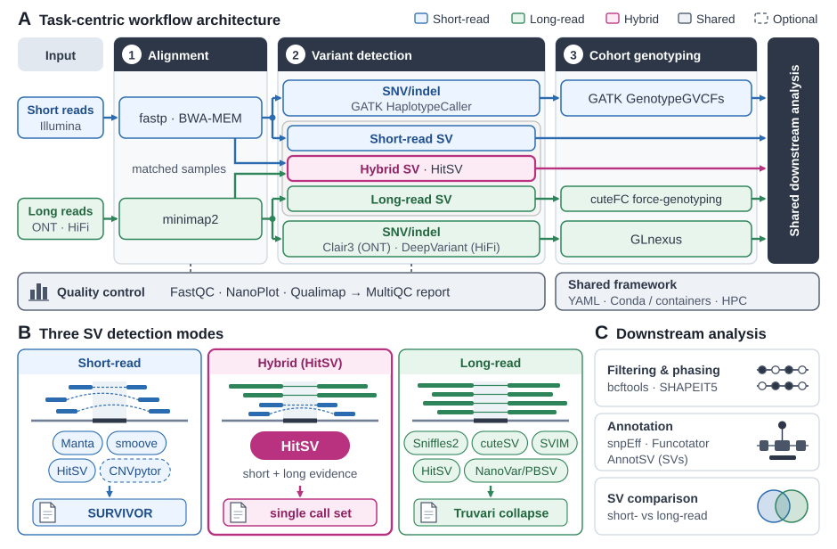

# HitFlow

[](https://snakemake.github.io)

HitFlow is a Snakemake workflow for germline genome variant analysis of short reads (Illumina), Oxford Nanopore (ONT) reads and PacBio HiFi reads. It covers read QC and alignment, SNV/indel and structural variant (SV) calling, hybrid short/long-read SV calling, cohort joint genotyping, statistical phasing, functional annotation and an aggregated MultiQC report.

Modules are organised by analysis task rather than by sequencing platform, and they are switched on in a single YAML configuration file. A run can therefore be one step, such as long-read SV calling, or a complete short- and long-read analysis. HitFlow has been used in the China 100K Genomes Project to process more than 25,000 short-read genomes and several hundred long-read genomes.



## Pipeline summary

| Task | Short reads | Long reads (ONT / HiFi) |
| --- | --- | --- |
| Read QC and preprocessing | FastQC, fastp | NanoPlot |
| Alignment and alignment QC | BWA-MEM, samblaster, sambamba, GATK BQSR; Qualimap; optional VerifyBamID2 | minimap2 with platform presets |
| SNVs and indels | GATK HaplotypeCaller (per-chromosome GVCFs); optional single-sample hard filtering | Clair3 (ONT), DeepVariant (HiFi) |
| SV calling | Manta, smoove/LUMPY; optional CNVpytor and HitSV | Sniffles2, cuteSV, SVIM, NanoVar (ONT) or PBSV (HiFi); optional HitSV |
| Per-sample SV merging | SURVIVOR (default) or Truvari collapse | Truvari collapse (default) or SURVIVOR |
| Cohort small variants | GATK GenomicsDBImport and GenotypeGVCFs; optional VQSR | GLnexus (default) or GATK |
| Cohort SVs | SURVIVOR (default) or svtools with SVTyper re-genotyping | cuteFC force calling, then SURVIVOR |
| Phasing | SHAPEIT5 (statistical) | SHAPEIT5 (statistical) |
| Annotation | Funcotator or snpEff; AnnotSV for SVs | snpEff or ANNOVAR; AnnotSV for SVs |
| Reporting | MultiQC | MultiQC; per-sample NanoPlot reports |

For individuals sequenced with both technologies, HitSV Hybrid calls SVs from the short- and long-read BAMs together. A separate comparison module reports which SVs are found by short reads only, by long reads only, or by both.

<details>
<summary>Default container versions</summary>

| Tool | Version | Tool | Version |
| --- | --- | --- | --- |
| FastQC | 0.12.1 | minimap2 | 2.28 |
| fastp | 0.24.3 | NanoPlot | 1.43.0 |
| BWA-MEM | 0.7.19 | Clair3 | 1.2.0 |
| samblaster | 0.1.26 | DeepVariant | 1.9.0 |
| sambamba | 1.0.1 | GLnexus | 1.4.3 |
| Picard | 3.4.0 | Sniffles2 | 2.4 |
| GATK4 | 4.6.2.0 | cuteSV / cuteFC | 2.1.1 / 1.0.2 |
| Qualimap | 2.3 | SVIM | 2.0.0 |
| VerifyBamID2 | 2.0.1 | NanoVar | 1.8.1 |
| Manta | 1.6.0 | PBSV | 2.11.0 |
| smoove | 0.2.5 | SURVIVOR | 1.0.7 |
| CNVpytor | 1.3.1 | Truvari | 5.4.0 |
| HitSV | 2.0.4 | AnnotSV | 3.5.3 |
| SHAPEIT5 | 5.1.1 | snpEff / SnpSift | 5.2 / 5.1d |
| BCFtools | 1.22 | SAMtools | 1.20 |
| VCFtools | 0.1.16 | MultiQC | 1.33 |
| svtools | 0.4.0 | SVTyper | 0.7.0 |

ANNOVAR is not distributed with HitFlow; obtain it from the [ANNOVAR website](https://annovar.openbioinformatics.org/) under its own license.

</details>

## Requirements

- Linux x86_64. HitFlow is tested on CentOS 7 with Slurm.
- Snakemake 9 (tested with 9.13.7). Slurm runs also need `snakemake-executor-plugin-cluster-generic`.
- Apptainer/SingularityCE (recommended) or Conda/Mamba. The container images pin the versions listed above. Conda environment files give version ranges, so Conda may install newer releases. DeepVariant and GLnexus are available only as containers, so runs that use them need container support.
- Internet access on the machine that runs the main Snakemake process, which creates Conda environments and pulls images. Compute nodes do not need internet access if the reference data and the binaries below were downloaded beforehand.
- Manta, SHAPEIT5 and HitSV are installed from their official release binaries into `bin/` by `scripts/download_files.py` (see [Reference data](#reference-data)).

## Installation

```bash
git clone https://github.com/jiuwen236/HitFlow.git
cd HitFlow
mamba create -n snakemake -c conda-forge -c bioconda \
    snakemake=9.13.7 snakemake-executor-plugin-cluster-generic
conda activate snakemake
```

## Quick start: check the software environment

`config/env_check.yaml` runs a few tools (by default bcftools, fastp and minimap2) through the same Conda environments or containers that the analysis rules use. It also checks that each command really comes from that environment or container. No samples or reference data are needed.

```bash
snakemake --configfile config/env_check.yaml --profile profiles/local-apptainer --cores 2
# Conda instead of containers:
snakemake --configfile config/env_check.yaml --profile profiles/local-conda --cores 2
```

The summary is written to `results/env_check/report.tsv`. The first run downloads the selected images or builds the Conda environments. Other tools that can be checked are listed in `config/env_check.yaml`.

To test a real analysis on a small short-read sample, see [docs/test_data.md](docs/test_data.md).

## Running an analysis

1. Prepare the reference data and sample sheets (see below).
2. Write a `config.yaml`. The configurations used for the paper's HG002 accuracy benchmarks are in [config/examples/](config/examples/) and are a good starting point. Switch modules on under `workflows`, then set `reference.genome`, the sample sheets and the output paths. Settings that usually need changing are near the top of the file.
3. Run with a dry run first. HitFlow can be run from its own directory or from any other directory. Relative paths in the configuration are resolved against the working directory. Bundled scripts are always found next to the `Snakefile`.

```bash
# From the HitFlow directory
snakemake -n --configfile config.yaml                                   # dry run
snakemake --configfile config.yaml --profile profiles/local-apptainer --cores 32

# From a separate run directory that contains config.yaml
cd /path/to/run
snakemake -s /path/to/HitFlow/Snakefile -n
snakemake -s /path/to/HitFlow/Snakefile --profile /path/to/HitFlow/profiles/slurm-apptainer \
    --apptainer-args "-B /path/to/HitFlow --cleanenv"
```

Profiles for local and Slurm execution with Apptainer or Conda are in `profiles/`. Jobs go to the cluster's default Slurm partition. If your cluster has no default partition, or you need an account, add `-p <partition>` or `--account` to `cluster-generic-submit-cmd`. With Apptainer, the working directory is mounted automatically. When running from a separate directory, also mount the HitFlow installation directory so bundled scripts and binaries are accessible. Add every other directory that holds inputs, references or databases to `apptainer-args`, for example `"-B /data,/refs --cleanenv"`.

Each rule takes its threads, memory and runtime from the configuration. Several memory-intensive rules raise their memory request by 1.5× on each retry, up to `cluster.retry_max_mem_mb` (128 GiB by default).

As an alternative to profiles, `scripts/run_snakemake.sh` wraps the same options:

```bash
/path/to/HitFlow/scripts/run_snakemake.sh --slurm [partition] -s /path/to/HitFlow/Snakefile \
    --sdm apptainer --apptainer-args "-B /path/to/data --cleanenv"
/path/to/HitFlow/scripts/stop_snakemake.sh   # stop the run in the current directory and cancel its Slurm jobs
```

### Workflow modules

| `workflows.*` switch | Runs |
| --- | --- |
| `enable_basic_ngs_workflows` | Short-read QC, alignment, BQSR and per-chromosome GVCFs |
| `enable_ngs_single_sample_filtering` | Short-read single-sample genotyping, hard filtering and annotation |
| `enable_ngs_sv_detection` | Short-read SV calling, merging and annotation |
| `enable_ngs_joint_calling` | Short-read cohort joint genotyping; VQSR and phasing via `vqsr.enabled` and `phasing.enabled` |
| `enable_tgs_variant_calling` | Long-read SNV/indel calling |
| `enable_tgs_variant_annotation` | snpEff or ANNOVAR annotation of long-read single-sample calls |
| `enable_tgs_sv_detection` | Long-read SV calling, merging, force calling and annotation |
| `enable_tgs_joint_calling` | Long-read cohort joint genotyping |
| `enable_tgs_phasing` | Phasing of long-read cohort calls (also set `tgs_joint_calling.phasing.enabled`) |
| `enable_cross_platform_sv` | Comparison of short- and long-read SV calls from paired samples |
| `enable_cross_platform_sv_cohort` | Integration of a short-read and a long-read cohort SV VCF into one site catalogue (`cross_platform_sv_cohort`) |
| `enable_multiqc` | MultiQC report |
| `enable_env_check` | Environment check only |

The long-read platform is set once per run with `tgs_config.platform` (`ONT` or `PACBIO_HIFI`). HitSV is off by default. To use it, add the keys from `config/hitsv.yaml` to your configuration; [config/examples/hg002_hybrid_sv/](config/examples/hg002_hybrid_sv/) shows a complete Hybrid setup. HitFlow merges repeated top-level keys in its YAML files, so you can append such an overlay to the end of `config.yaml`.

- **Short-read cohort SVs:** set `ngs_sv.cohort_merge_method: svtools` to use
  Smoove/LUMPY calls and re-genotype the merged sites with SVTyper. This requires
  `ngs_sv.smoove.enabled: true` and `ngs_sv.survivor.enable_population_merge: true`;
  the default `survivor` method merges the per-sample multi-caller call sets.
- **Paired cross-platform SVs:** `cross_platform_sv.method` selects `survivor`
  (default) or `truvari` for `enable_cross_platform_sv`.
- **Cross-platform cohort SVs:** enable `workflows.enable_cross_platform_sv_cohort`
  and set `cross_platform_sv_cohort.method` to `survivor` (default) or `truvari`.
  Inputs default to this run's short- and long-read cohort outputs; alternatively,
  set `cross_platform_sv_cohort.ngs_vcf` and `tgs_vcf` to existing cohort VCFs with
  genotypes. Both must use the same reference assembly and chromosome names. The
  cohorts may contain different individuals; `samples_pairs_csv` is not required.

### Input

| Data | Configuration key | CSV columns |
| --- | --- | --- |
| Short-read FASTQ or BAM | `samples_csv` | `sample,fq1,fq2`; optional `bam` |
| Existing short-read GVCFs | `samples_vcf_csv` | `sample,raw_hc_dir` (directory with per-chromosome GVCFs) |
| Long-read FASTQ or BAM (ONT and HiFi) | `samples_ont_csv` | `sample,file_path`; optional `aligned` (`true`/`false`) |
| Matched short/long-read samples | `samples_pairs_csv` | `pair_id,ngs_sample,tgs_sample` |
| Directory scan instead of CSV | `scan_ngs_dirs`, `scan_tgs_dirs` | – |

```csv
sample,fq1,fq2
S1,data/S1_L1_1.fq.gz,data/S1_L1_2.fq.gz
S1,data/S1_L2_1.fq.gz,data/S1_L2_2.fq.gz
```

```csv
sample,file_path,aligned
L1,data/ont/L1/,false
L2,data/ont/L2.bam,true
```

- **Multiple files per sample:** several rows with the same sample name (lanes or runs) are combined automatically. Paths may contain glob or brace patterns. Quote any field that contains a comma, such as `"{1,2}"`.
- **Long-read paths:** a long-read path ending in `/` is searched for FASTQ files. Pre-aligned BAMs must use the configured reference. Setting `aligned` saves HitFlow from inspecting each BAM.
- **Check the sample list:** the resolved sample lists are written to `logs/ngs_samples_*.csv` and `logs/tgs_samples_*.csv`. Check them before a large run.
- **Exome data:** for whole-exome data, set `wes.targets_bed`.

### Reference data

GRCh38 is recommended, and GRCh37 is also supported. The reference FASTA and indexes, known-sites and VQSR resources, VerifyBamID2 SVD files, annotation databases and genetic maps must all use the same assembly and chromosome names.

```bash
python3 scripts/download_files.py --config config.yaml -n   # list the files needed by the enabled modules
python3 scripts/download_files.py --config config.yaml      # download them into ref_data/
```

`download_files.py` provides GRCh38 resources. Use `--all` to download everything, `-r` to resume interrupted downloads, and `--proxyHost`/`--proxyPort` to go through a proxy. Run it from the HitFlow directory: it writes to `HitFlow/ref_data/` and reads `--config` relative to that directory. When running from another directory, link that `ref_data/` there or use absolute paths in the configuration. For ANNOVAR databases, use `scripts/download_annovar_databases.sh`. For GRCh37, provide the matching resources yourself.

## Output

Main results, with the default output paths:

```text
results/
├── ngs/
│   ├── alignment/{sample}/bam/{sample}.dup.sorted.recal.bam
│   ├── variants/single_sample/{sample}/variant_calling/normalized/{sample}.filtered.normalized.vcf.gz
│   ├── variants/cohort/filtered/cohort.filtered.recode.vcf.gz      # also vqsr/ and phased/
│   ├── structural_variants/single_sample/{sample}/merged/{sample}.ngs_sv.merged.vcf.gz
│   └── structural_variants/cohort/merged/cohort.ngs_sv.merged.vcf.gz
├── tgs/
│   ├── preprocessing/{sample}/alignment/{sample}.{ont|pb}.sorted.bam
│   ├── variants/single_sample/{sample}/{clair3|deepvariant}/{sample}.{caller}.norm.vcf.gz
│   ├── variants/cohort/filtered/cohort.filtered.recode.vcf.gz
│   ├── structural_variants/single_sample/{sample}/final/{sample}.sv.final.vcf.gz
│   └── structural_variants/cohort/population.merged.vcf
└── multiqc/multiqc_report.html
```

Annotation tables are written next to the corresponding VCFs. Rule logs are in `logs/`, per-rule benchmark records (runtime, CPU, memory and I/O) are in `logs/benchmarks/`, and Slurm logs are in `logs_cluster/`. To create a Snakemake run report, use `snakemake --report report.html`. A full list of output files is in [docs/output.md](docs/output.md).

## Benchmarks

Accuracy on HG002 (GRCh38). Small variants were evaluated against GIAB v4.2.1 with hap.py, and SVs against the HG002 Q100 v1.1 benchmark with Truvari (size similarity 0.7):

| Data | SNV F1 | Indel F1 | SV F1 |
| --- | --- | --- | --- |
| Short reads | 0.991 | 0.971 | – |
| PacBio HiFi | 0.989 | 0.983 | 0.788 (Sniffles2), 0.793 (cuteSV), 0.796 (≥2 callers) |
| ONT (~30×) | 0.988 | 0.873 | 0.779 (Sniffles2), 0.785 (cuteSV) |

For 30× short reads combined with 4× HiFi, HitSV Hybrid reached a mean SV F1 of 0.764. Merging the Manta, smoove, Sniffles2 and cuteSV call sets reached 0.620.

An end-to-end run on a Slurm cluster processed 60 short-read and 57 ONT whole genomes in 4,632 jobs. It used about 25,171 CPU-hours, or about 215 CPU-hours per genome. The highest per-job memory peaks were Clair3 (81 GB), GLnexus (64 GB), minimap2 (48 GB) and Qualimap (45 GB).

## License

HitFlow is released under the MIT License; see [LICENSE](LICENSE).

HitFlow runs third-party tools under their own licenses; they are installed as containers, Conda packages or official release binaries and are not part of this repository. HitSV and AnnotSV are GPL-3.0, and ANNOVAR requires its own license.

## Support

Please report bugs and ask questions through [GitHub Issues](https://github.com/jiuwen236/HitFlow/issues).
